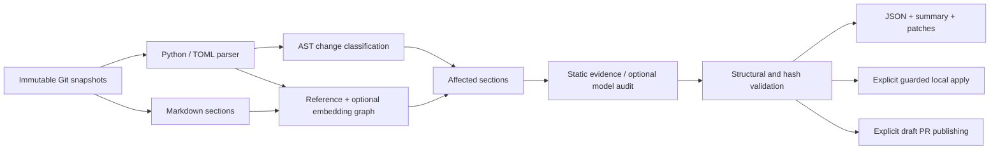

# Module contracts

| Module | Input | Output | Responsibility |
|---|---|---|---|
| `models` | typed source/evidence values | code units, sections, changes, findings, edits, reports | Stable IDs, hashes and shared contracts |
| `config` | TOML at trusted base | validated bounded config | Reject unknown keys, invalid budgets and unsafe provider URLs |
| `gitstore` | repository + commit refs | immutable UTF-8 blobs, scoped diff hunks | Reject unsafe refs, symlinks and over-budget snapshots; never execute target code |
| `codeparse` | Python/TOML source | semantic code units | Function signatures, class schemas, endpoint/CLI decorators and configuration facts |
| `docparse` | Markdown/MDX | exact, nonoverlapping sections | Heading paths, duplicate heading IDs and fenced-code handling |
| `mapping` | code units + sections | persistent code-to-doc graph | Explicit references and optional actual embedding cosine similarity |
| `changes` | before/after code units | contract / behaviour / addition / removal | Ignore comments, formatting and docstring-only changes; conservatively review body refactors |
| `diagnosis` | linked section + old/new evidence | finding + optional edit | Bounded declaration rules; optional model diagnosis, generation and validation |
| `provider` | explicit endpoint/model + bounded evidence | contract-validated JSON or vectors | HTTPS, no redirects, timeout/retry limits; no raw credential/error-body logging |
| `repair` | guarded edits + current files | changed Markdown or explicit refusal | Heading/fence/link preservation, exact hashes/spans, lock, atomic writes and rollback |
| `pipeline` | snapshots/config/adapters | report + graph | Link changed symbols to suspects and preserve coverage limitations |
| `reporting` | report + snapshots | JSON, Markdown, safe/draft unified patches | Escape untrusted report cells and separate model drafts from static edits |
| `github` | freshly computed report + explicit write authorization | draft PR + summary comment URLs | Same-repo checks, SHA rechecks, bounded scans and non-forceful reruns |
| `cli` | validated command arguments | artifacts + documented exit code | Explicit remote-write boundary and safe-edit recomputation before local apply |
| `entrypoint.py` | GitHub event and action inputs | step summary/output + CLI result | No shell interpolation; refuse fork secrets and target-context events |

A finding marked `accurate` by the static rule means the explicit declaration matches the new contract. It is not a certification of every sentence in the section. A `review` finding is unresolved evidence, not a confirmed stale diagnosis. Unmapped changed symbols produce coverage warnings rather than a false clean bill of health.
